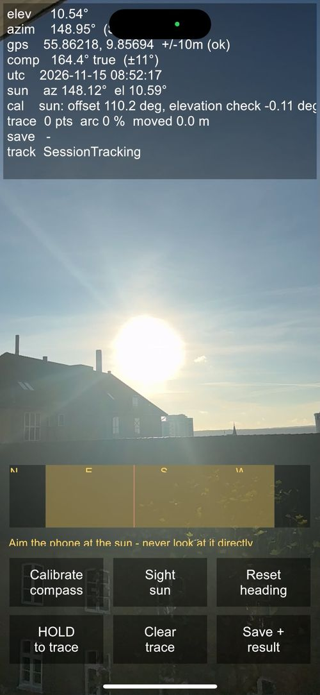
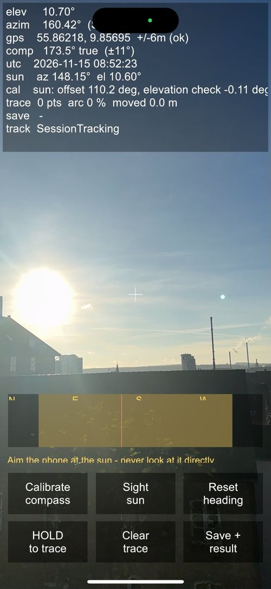
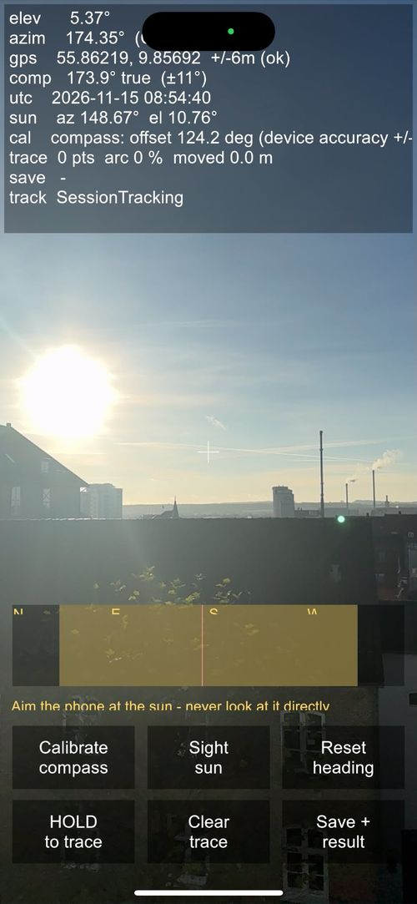
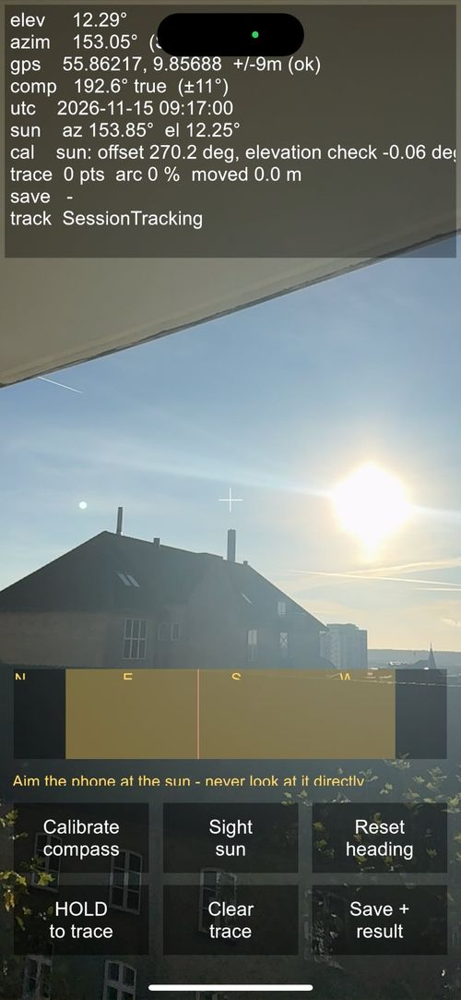
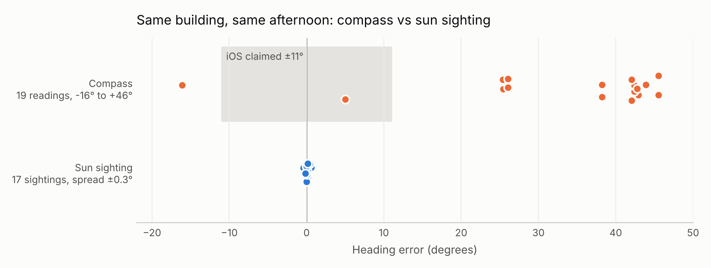

# Week 3 — Finding north

Week one ended with an uncomfortable discovery. Of the two angles this app measures, one is free and one is the entire problem.

Elevation comes from gravity, and ARKit knows which way is down to a fraction of a degree. Azimuth comes from nowhere. When an AR session starts, it picks a forward direction and calls that zero. It has no idea where north is. Every bearing I measure is relative to wherever I happened to be pointing when the app launched.

So before a single roofline can be traced, I need to answer one question: how many degrees do I add to the AR bearing to get a real compass bearing? That number is the heading offset, and every degree of error in it moves the whole skyline sideways by a degree.

## How much does a degree matter?

More than I expected. In November the sun moves along the horizon at about 14 degrees an hour. I measured that directly: two readings nine minutes apart moved 2.1 degrees.

So a 14-degree heading error doesn't just shift a chimney on a chart. It moves the predicted moment the chimney shades the panel by about an hour. For a solar survey, that's the difference between "loses the morning" and "loses the middle of the day", and the middle of the day is when the energy is.

## Option one: the compass

The obvious answer is the phone's magnetometer. iOS gives a true heading and its own accuracy estimate. Point the phone, read the compass, and the difference between the compass bearing and the AR bearing is the offset.

It's one tap, and it works in any weather. It's also the option every source I read warned about. Magnetometers get pulled by steel beams, rebar, window frames, cars, laptops, and the phone's own speaker magnet.

## Option two: the sun

The better answer comes from surveying, where it's older than GPS. If you know the exact time and your position, you know exactly where the sun is. My solar engine from week two computes that to a few hundredths of a degree.

So: put the crosshair on the sun, tap, and the offset is the sun's computed azimuth minus the AR azimuth the camera is pointing at. No magnetism involved.

The part I like is the built-in lie detector. At the moment of sighting, the camera also measures the sun's *elevation*. Elevation needs no calibration, so it should match the computed value. If it doesn't, either my aim was off, or the phone's clock is wrong. A wrong clock is the dangerous case, because it would shift every azimuth silently. So any sighting where elevation disagrees by more than 2 degrees is rejected outright, and the app refuses to sight a sun lower than 5 degrees, where refraction is largest and aiming is hardest.

(The app also says this on screen, every time: aim the phone, watch the screen, never look at the sun.)

## The field test

Sunday 15 November, about 10:00 in the morning, at an upstairs window in Horsens. The sun was 10.6 degrees up in the south-south-east. Everything happened inside one AR session, so all the offsets share a frame and can be compared directly.

| Calibration | Time (UTC) | Offset | Elevation check |
|---|---|---|---|
| Sun sighting 1 | 08:52:04 | 110.7° | −0.35° |
| Sun sighting 2 | 08:52:17 | 110.2° | −0.11° |
| Compass | 08:52:41 | 123.6° | — |
| Sun sighting 3 | 08:53:52 | 110.9° | +1.26° |
| Compass | 08:54:05 | 124.2° | — |

*Sun sighting at 08:52:17. The `cal` line shows the offset and the elevation cross-check.*

Three sun sightings agree to within 0.7 degrees: a mean of 110.6 and a standard deviation of 0.4. The third had the worst elevation check of the three, +1.26 degrees, which suggests a slightly sloppy aim, and it's also the one furthest from the mean. The lie detector is doing its job.

The two compass calibrations agree with *each other* well. But they're 13.0 and 13.6 degrees away from the sun. That's a consistent error, not noise. At that window, the compass reads about 13 degrees too far clockwise.

iOS was reporting its own accuracy as ±11 degrees the whole time. The real error was outside that.

## Checking it a third way

Two calibration methods that disagree tell you that one of them is wrong, but not which. I wanted an independent check, and the screenshots contained one.

In some frames the sun was visible but well away from the crosshair. Knowing the camera's focal length from week one, I can convert the sun's pixel offset from the centre into an angle. That predicts where the sun is, using only the heading calibration and the camera, and I can compare it with the astronomy.

- **Sun-calibrated frame (08:52:23).** The crosshair reads 160.4°, and the sun sits about 12.1° to its left. That places the sun at 148.3°. The computed position is 148.15°. **0.2 degrees apart.**
- **Compass-calibrated frame (08:54:40).** Same method: the sun appears at about 162°. The computed position is 148.7°. **13.5 degrees apart**, which is the compass error again, found by a route that doesn't involve the compass or the sun-sighting button.

*Left: sun-calibrated, the sun sits where the heading says it should. Right: compass-calibrated, the same check is 13.5 degrees out.*

The pixel measurement is rough, because the sun's glare is much bigger than the disc. Even so, it agrees with the sightings to a fraction of a degree and disagrees with the compass by exactly the amount the sightings predicted.

## The compass doesn't just have an offset

One more thing showed up when I compared the live compass reading against the sun-calibrated bearing as I turned the phone. Between 150 and 175 degrees, the compass was 13 to 14 degrees out. Swinging the phone left to about 135 degrees, or right to about 200, it was closer to 17. Part of that is lag: the compass reading trails the AR tracking when the phone moves. Part of it is that a magnetic disturbance isn't a constant. A steel window frame bends the field differently depending on which way you face.

That's the real argument against the compass. A constant offset could be calibrated out once. An error that changes with direction and position can't.

## The hole in my lie detector

Twenty minutes later I found the flaw in my own safety check, by accident.

I was trying to measure landmarks and kept pressing "Sight sun" while the crosshair sat on a chimney instead of the sun. Three of those attempts were rejected, as they should be. Two were accepted, and they moved the heading by 10 and 7.5 degrees.

The reason is obvious once you see it. The sun was 12.2 degrees up. The chimney tops I was aiming at were also about 12 degrees up, just ten degrees to one side. The elevation check compares elevations, so it can't see a sideways mistake. It caught the bad aims that happened to be too high or too low, and missed the ones that happened to be level with the sun.

*Accepted, and wrong: the crosshair is in empty sky about 11 degrees left of the sun, at almost exactly the sun's elevation.*

The fix uses the one thing a single sighting can't provide: a second sighting. A new sun sighting that disagrees with the previous accepted one by more than 2 degrees is now rejected, and the screen asks whether the crosshair is really on the sun. If the *first* sighting was the bad one, Reset heading starts over. Two sightings agreeing within 2 degrees by chance, while both aimed at the wrong thing, is far less likely than one.

After a reset, the next two sightings agreed to 0.5 degrees.

## The afternoon, from the log

By the afternoon the app was writing every calibration attempt to `calibrations.csv` (it's in `Data/2026-11-15/`). That gave 23 attempts across eight AR sessions, at the window and at a roof window in the same building, with no screenshots needed.

- **Sun sightings within a session:** 17 sightings in 6 sessions with more than one sighting. Pooled spread ±0.3 degrees, largest range 1.2 degrees.
- **Compass:** each accepted sun sighting also reads the compass at the same moment. Over 19 readings, the compass error ran from **−16 to +46 degrees**, with a mean of +34. It reported ±11 to ±13 degrees accuracy throughout.
- **Rejections:** four attempts were refused. Three failed the elevation check, by 2.5 to 3.5 degrees. The fourth is the interesting one. Its elevation was only 1.0 degree off, which passes, but its offset was 38 degrees from the sighting just before it. The new agreement rule caught it, a few hours after I wrote it.

The morning's "13 degrees" was not the compass error at that window. It was one draw from a distribution 60 degrees wide.

## What the app does now

- **Two sightings must agree** within 2 degrees, or the second is rejected.
- **Sun sighting is the primary reference**, reported as ±0.5°. Compass is the fallback for cloudy days, reported as ±5°. Today's data says even that is optimistic near steel, so the results screen tells the user to sight the sun if they used the compass.
- **Recalibrating costs nothing.** Skyline samples are stored in the AR session's own frame, not as compass bearings. If the sun comes out halfway through a survey, one sighting re-projects everything already traced.
- **Every calibration is logged**, accepted or rejected, to a CSV file on the phone, together with the compass reading at that moment. Each sun sighting therefore measures the compass error for free. This week's numbers came from screenshots; next time they come from a file.
- **A live "compass vs sun" line** appears on screen once the sun has been sighted, so the compass error can be watched while walking around.

## The honest caveats

This is one building and one day: about 30 calibrations. It's enough to see that the compass error is real and about fifty times larger than the sun-sighting spread (a standard deviation of 15.6 degrees against 0.3). It isn't enough to put a number on compass error in general. It was also measured at a window, which is probably the worst case for a magnetometer: there's a metal frame inches away.

The open-air surveys in the validation post will add more sightings away from the building, and I'll report the compass error there too. If it's much smaller in the open, that's worth knowing. It would mean the compass is fine in a garden and bad on a balcony, which is exactly where people put small solar panels.

*Update after the outdoor surveys:* it is. In the open, 30 sightings put the compass within −11 to +4 degrees. At the window the same morning it was +47. See [post 6](06-validation.md).

## Next

Tracing the skyline, and the decision to do it by hand instead of with the automatic sky detection I planned in week one.
