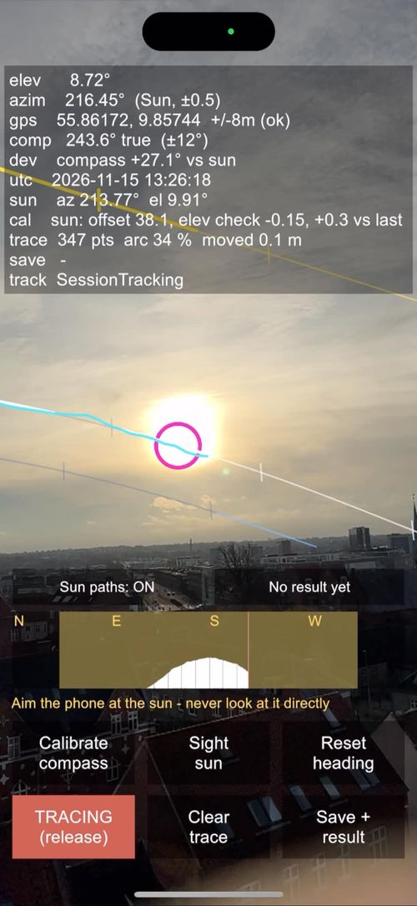
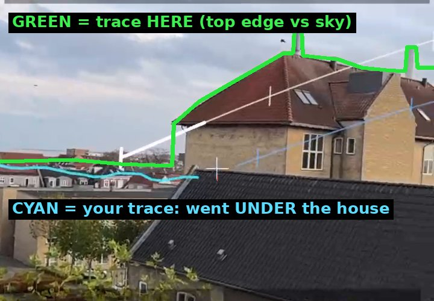
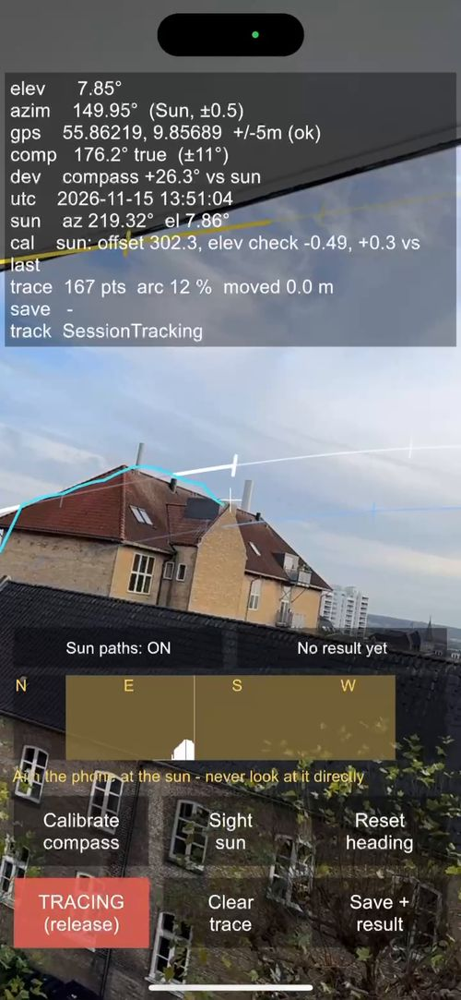
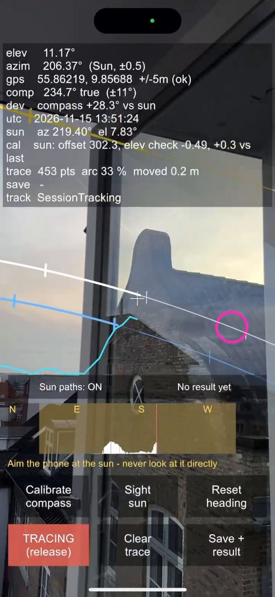

# Week 4 — Tracing the skyline

With north solved, the app knows which way every bearing points. Now it needs the thing it was built to measure: the outline of everything that blocks the sky from where you stand.

That outline is the horizon profile. It's 360 numbers, one per degree of bearing, and each one says how high the obstruction reaches at that bearing. A flat field reads close to zero all the way round. A courtyard might read 30 degrees to the south and 5 degrees to the north. The solar engine from week two takes those 360 numbers and does the rest.

## The plan I dropped

In week one I planned to do this automatically. Point the camera at the sky, split each frame into bright sky and dark obstruction, find the boundary in every column of pixels, and build the profile with no effort from the user. It's on the README's original roadmap as a full week of work.

I cut it, and I think it was the right call. Three reasons, all of which I could see in this week's field screenshots.

**The sun ruins the image exactly where it matters.** In November the sun is low, and the part of the skyline that decides the result is the part right under it. That's also where the camera is most dazzled. In my screenshots the glare around the sun is five to eight degrees across. A brightness threshold can't find a roofline inside a white blob.

**Trees lie to a camera.** In November the birches are bare, and a camera sees mostly sky through the branches. In June the same tree is a solid wall. Whether a tree counts as an obstruction is a judgement about the whole year, not a property of today's pixels. A person can make that call in a second. A threshold can't.

**Time.** Doing segmentation properly means mapping pixels to rays through the camera intrinsics, handling exposure changes as the phone turns, and then dealing with every failure above. That's a week. Manual tracing took an afternoon, and it's more accurate.

So the user traces the skyline with the crosshair instead. Commercial instruments generally let the user correct the automatic result by hand anyway, so a trace that is manual from the start is not a strange compromise. It's the part of the job that matters most, done by the thing best placed to do it.

## How tracing works

You hold the **Trace** button and turn slowly, keeping the crosshair on the top edge of whatever blocks the sky. Every frame becomes a sample: the AR bearing and the elevation of the crosshair. A few details make this better than it sounds.

**Samples are stored in the AR frame, not as compass bearings.** The heading offset is applied only when the profile is built. So if you trace first and sight the sun afterwards, or re-sight it halfway through, everything already traced is simply re-projected. Nothing has to be redone because the calibration changed.

**Only real movement counts.** A new sample is kept only once the crosshair has moved at least 0.2 degrees, so standing still doesn't pile up duplicates. Samples taken while ARKit's tracking is degraded are thrown away, because their pose can't be trusted.

**Each degree takes the median, not the maximum.** A hand trace wobbles. With the maximum, a single upward twitch would turn into a phantom wall. With the median, a second pass over the same stretch quietly improves the result instead of corrupting it. That's why the protocol asks for two passes.

**Standing still matters.** If you step sideways, every angle changes. The error is roughly atan(d / D) for a step of d metres against an obstruction D metres away. Half a metre against a building 30 metres off costs about a degree. The app tracks how far the phone has moved since tracing started and shows **STAND STILL** above one metre.

## How much do you have to trace?

Not everything. At Horsens the sun's bearing over a whole year runs from 43 degrees, sunrise at the June solstice, to 317 degrees, sunset on the same day. Anything outside that arc can never shade anything, so the app only needs the arc in between. It shows it as the amber band on the strip at the bottom of the screen, which fills with white bars as you trace.

The app refuses to produce a result until at least 80 percent of that arc has been traced. Small gaps are filled by straight-line interpolation between their neighbours, but the filled degrees stay flagged as *inferred*, and the results chart draws them hatched so they can't be mistaken for measurements.

## What I got wrong in the field

This took three attempts to get right, and I learned something from each one.

**Attempt one: I traced the sun's path.** By the time I tested tracing, the app was already drawing the sun's path for today as a bright white line across the sky. It was the most obvious thing on the screen, and my trace followed it, straight through the sun. Saved, that would have meant a 15-degree wall all the way round, and a result that said the spot gets almost no sun.

The fix wasn't telling myself to be more careful. It was a design change: while you hold Trace, the sun paths and the sun marker now fade to a quarter of their opacity. The skyline you are tracing is the thing that should catch your eye.

**Attempt two: a straight line under the house.** I held the crosshair at the height of the distant horizon and swept across. It looked tidy. But the house across the yard rises to roughly 10 degrees, and the line went straight under it. Saved, that would have told the app the morning sky was open, when that house is what shades it.

**Attempt three: right.** Up the roof slope, over both chimneys, down the far side, along the distant horizon, then up the stepped brick gable on the right. The cyan line in the camera view is the trace itself, drawn back into the scene. That turned out to be the best feedback the app has: you can see immediately whether your line sits on the roof or floats in front of it.

## The gate did its job

All of that was from a window, and none of it could be saved. From inside the window you can see about 115 to 225 degrees, so arc coverage stops near 39 percent. The rest of the sky is hidden by the wall.

That is exactly what the 80 percent rule is for. Without it, the app would have filled the missing 60 percent by interpolation and reported a confident, completely wrong number. With it, the app said "only 39% of the sun's arc traced" and refused. The real surveys are done outdoors, from an open spot. They're the subject of the validation post.

## Next

Drawing the sun's path onto the real sky, and turning the profile into an answer someone can actually use.
