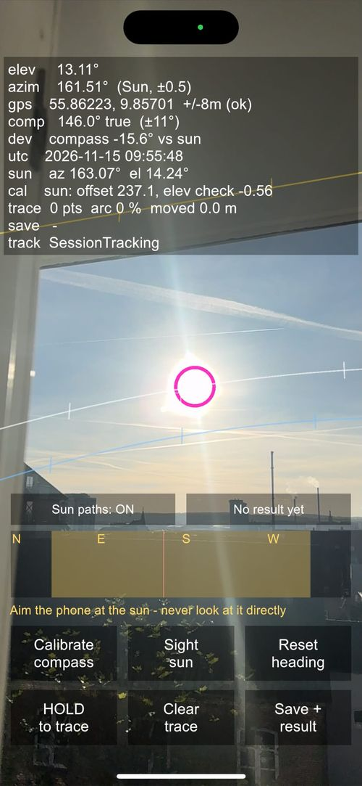
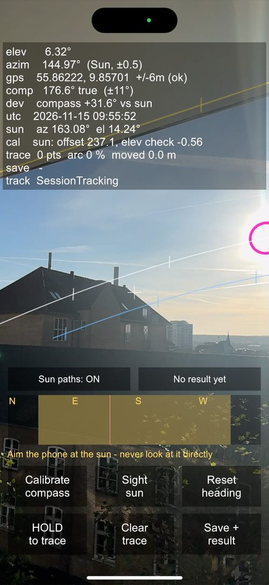
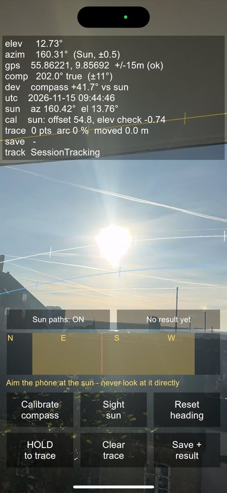
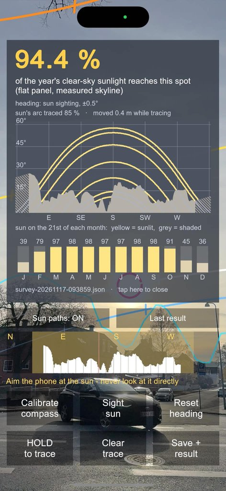

# Week 5 — The sun on the real sky

Everything up to now produced numbers. This week is about the part that makes it an AR project you can see: the sun's path drawn onto the real sky, in the live camera view, lined up with the actual roofs. Plus a results screen that turns 360 numbers into an answer.

## What you see

Four paths across the sky, each with a tick at every full hour:

| Colour | Day |
|---|---|
| Orange | June solstice, the highest path |
| Yellow | Equinox |
| Blue | December solstice, the lowest |
| White | Today |

And a magenta ring where the sun should be right now.

Where a path passes behind the traced skyline, it is drawn thin and dim. That's the moment of the year when this spot is in shade, visible at a glance. In the right-hand picture, the white and blue paths cross the house: in November and December, the morning sun at this window is behind that roof.

## How the overlay is placed

The sky is, for practical purposes, infinitely far away. So the paths sit on a sphere with a 15-metre radius that follows the camera's position but never its rotation. If you walk a step, the sky doesn't come closer.

Inside that sphere, every point is laid out by its true bearing and elevation, straight from the solar engine. The whole sphere is then turned by minus the heading offset from week three. That one rotation converts true bearings into the AR session's own frame, the same frame the camera moves in.

This has a nice consequence. Recalibrating the heading doesn't rebuild anything. It turns the sphere. Sight the sun again, and every path swings into place at once.

The elevation needs one detail. Week one measured that ARKit reads elevations 0.31 degrees low, and the app corrects for it when it *reads* the crosshair. To draw a point that the crosshair would read correctly, the overlay has to apply the same correction in reverse. The self-check now tests exactly that: a point drawn at any bearing and elevation, read back through the crosshair maths, comes out within a thousandth of a degree. That's checks 38 and 39 of 39.

## Did it land in the right place?

Pictures of lines on a sky are easy to fake by accident, so I checked the screenshots against the astronomy.

- **Today's path goes through the sun.** It has to, but it's a good first check.
- **The 11:00 tick** should sit 15 minutes ahead of the sun at 10:45, about 3.6 degrees to its right. That's where it is.
- **Hour ticks are about 14 degrees apart.** That matches how fast the sun moves along the horizon in November, measured independently in week three.
- **December's path is 4.2 degrees below today's** at this bearing. The solar engine predicts about 4.
- **The equinox path is about 31 degrees up** here, which is also what the engine predicts.

And the ring sits on the sun, from a heading calibrated by sighting that same sun a few minutes earlier, through a separate piece of code.

## Two things the field test changed

**The ring was white, and it disappeared.** My first version drew a thin white circle. A camera pointed at the sun shows a white blob several degrees wide, and a white ring inside a white blob is invisible. The ring only showed up in one screenshot, where the sun was half off the frame. It's now magenta, thicker, and twice the radius, so it sits outside the glare.

**The paths were too attractive.** As described in the last post, I traced the white path instead of the rooftops on my first attempt. While Trace is held, the paths now fade to a quarter of their opacity.

Both are small changes, and I wouldn't have found either of them at a desk.

## The results screen

When a survey is saved, the camera view is replaced by the answer, in three layers. They're ordered the way a homeowner would ask the questions.

**1. One number.** The percentage of the year's clear-sky sunlight that reaches this spot, for a flat panel, given the measured skyline.

**2. A sun chart.** Bearing across, elevation up. The measured skyline is drawn as a filled shape, hatched where it was inferred rather than traced. The sun's path on the 21st of each month is drawn over it: yellow where the sun is clear, grey where it's behind something. This is the same kind of diagram a SunEye prints, and it answers the question the number can't: *which* obstruction costs *when*.

**3. Monthly bars.** Twelve bars, one per month. For a spot in Denmark, the shape is almost always the same: summer near 100 percent, winter much lower, because the winter sun is the one low enough to be blocked.

Underneath, it states how the heading was found and how much of the arc was traced. If the heading came from the compass, it says so, and suggests sighting the sun.

The screen is drawn entirely from the saved survey file, not from the live trace. Any saved survey can be shown again later, and what's on screen is guaranteed to be what's in the file.

*The results screen after an outdoor survey on 17 November. Hatched areas at the ends were filled in, not traced. The winter months lose sun to the rooftops in the south.*

## What it doesn't do

The percentage is for a **flat** panel under a **clear sky**. Real panels are tilted, and Danish skies are often not clear. Tilt and weather change the absolute energy a lot. They change the *fraction lost to shading* less, though not to zero: a panel tilted south leans towards the low winter sun, so it loses a little more to the same skyline. The shading fraction is what this app measures. Turning it into kilowatt-hours is the job of a tool like PVGIS, which can take this app's horizon profile as an input. That comparison is part of the validation post.

## Next

[Validation](06-validation.md): repeat surveys of the same spot, the spread between them, the compass data from every calibration, and what a wrong north does to the answer.
