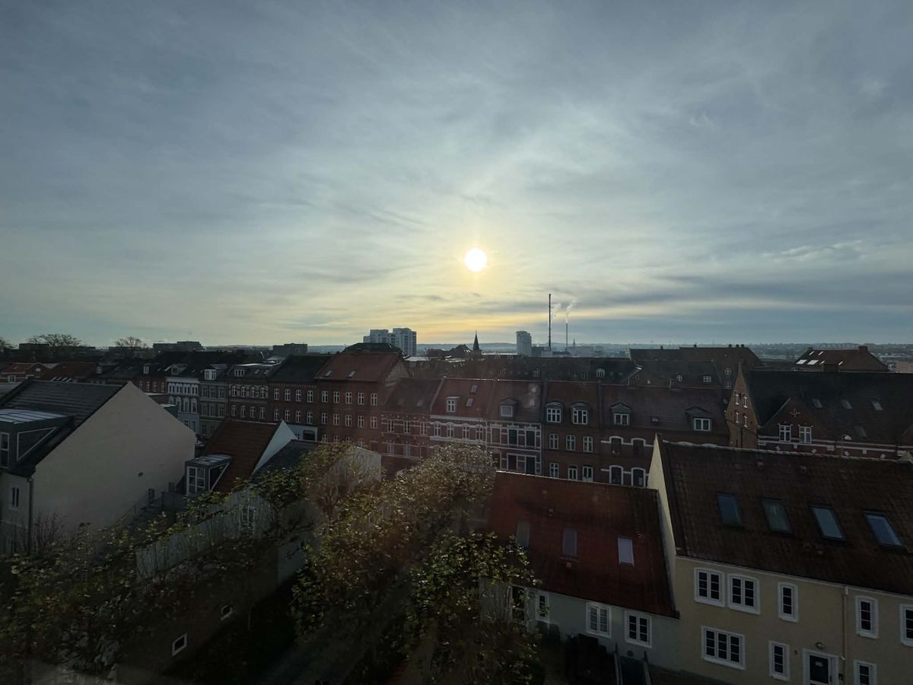
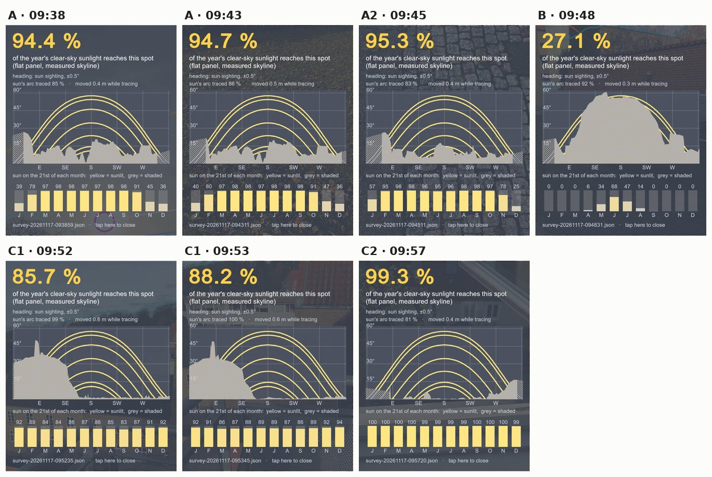
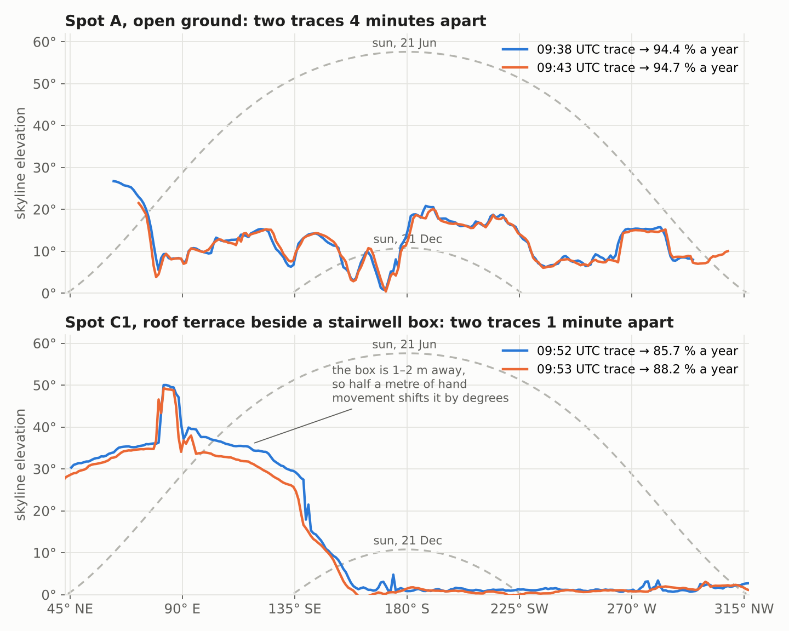
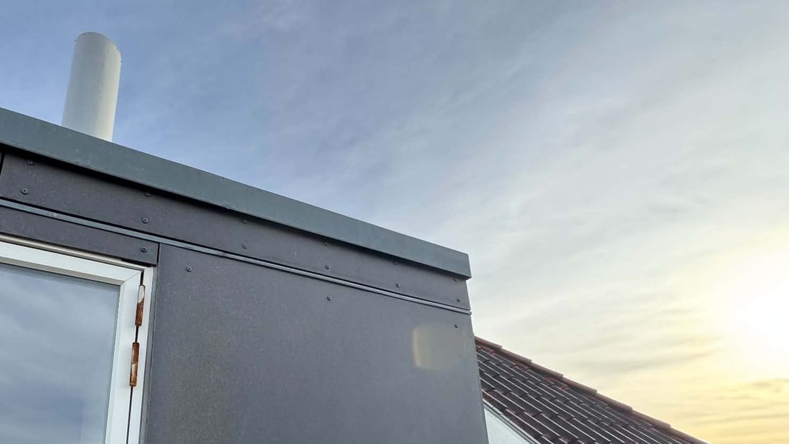
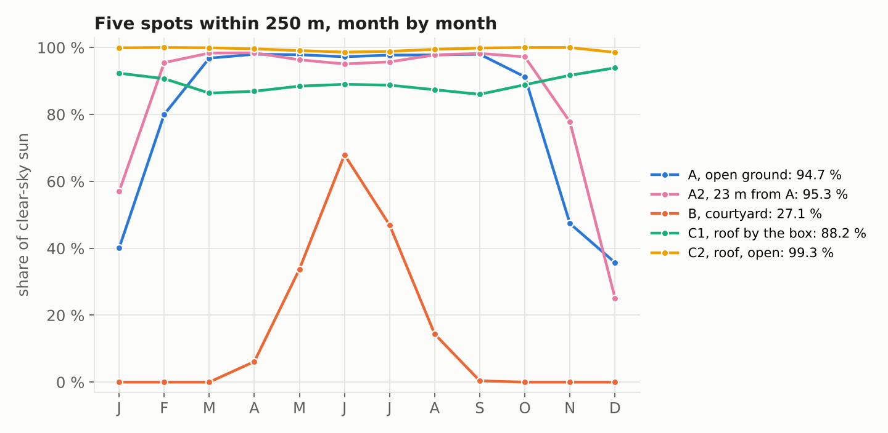
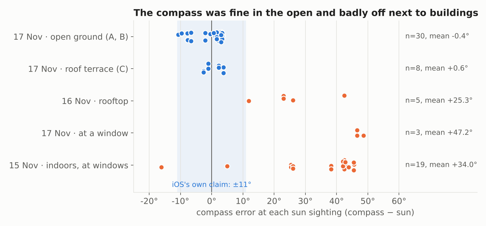
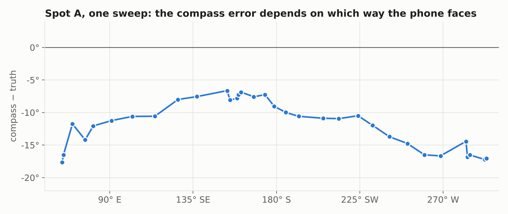
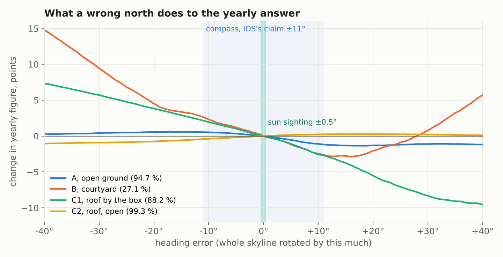

# Week 6 — Does it give the same answer twice?

Everything so far has been checked piece by piece: the angles in week one, the sun maths in week two, north in week three, the overlay in week five. This post checks the whole thing: stand somewhere, survey it, survey it again, and see whether the answer holds.

*The view south from the roof terrace on survey morning. The sun is about 13 degrees up. At noon in mid-November it only reaches 15.*

## The morning

Tuesday 17 November, a clear sky with high cloud, about half an hour of surveying. All times below are UTC, as in the file names. Local time was an hour later.

The phone saved **12 files**, but several are the same trace saved twice (I pressed Save more than once, and once re-saved an old trace after walking to the next spot). Hashing the skylines leaves **7 distinct traces at 5 spots**:

| Spot | Where | Traces | Yearly result |
|---|---|---|---|
| **A** | Grass verge by a street, a few metres from a large oak | 09:38, 09:43 | **94.4 %**, **94.7 %** |
| **A2** | Cobbles 23 m further along the same street | 09:45 | 95.3 % |
| **B** | A courtyard between brick buildings | 09:48 | 27.1 % |
| **C1** | The roof terrace of my building, right beside the stairwell box | 09:52, 09:53 | **85.7 %**, **88.2 %** |
| **C2** | The same roof terrace, about 10 m along, clear to the south and west | 09:57 | 99.3 % |

*The results screen for each of the seven traces.*

I planned five surveys of one spot. What I got is better for some questions and worse for others: two repeat pairs, A and C1, plus three more spots to show how much the answer changes when you move.

GPS on the roof was only good to 6 to 14 metres, so it can't tell C1 from C2. The skylines can. C1 has a wall up to 35 degrees in the east, with a narrow spike to 50 degrees. That's the stairwell box and the vent pipe on top of it. C2 has no such wall.

## Check zero: is the number on screen the number in the file?

Before comparing surveys, I wanted to know that nothing gets lost between the trace and the result. I wrote a Python version of the solar engine and the access calculation ([`Analysis/validate.py`](../Analysis/validate.py)), fed it the skyline saved in each file, and compared its answer with the number the phone saved.

**All seven agree to the second decimal place, annual and monthly.**

This is the same algorithm in a different language, so it doesn't prove the algorithm is right (that was week two's job). It proves that the saved files contain everything needed to reproduce the result, and that the phone did what the code says.

## Repeat 1: spot A, open ground

Two traces four minutes apart, each after a fresh sun sighting: **94.4 % and 94.7 %**.

The two skylines are hard to tell apart. Across the 223 degrees both of them covered, the median difference is **0.5 degrees**, and nine bearings in ten are within 1.7 degrees. The biggest gaps are at the edges of trees, where "the top of the oak" is a judgement call.

The monthly figures agree within 1.2 points in every month except November (2.3 points). That's the month where the low sun skims along the rooftops in the south, so small differences in the trace there count most.

## Repeat 2: spot C1, next to a box

Two traces one minute apart: **85.7 % and 88.2 %**, a gap of 2.4 points, eight times bigger than at spot A.

Almost all of it comes from one place. I swapped 30-degree slices of one skyline into the other to see which slice changed the answer: bearings 90 to 150 degrees account for 2.4 of the 2.4 points. That's the stairwell box.

The box is a couple of metres away. The sky doesn't move when you shift the phone, but something two metres away does: half a metre sideways changes its angle by about 14 degrees. While tracing I moved up to 0.56 m, which is within what the app allows. The app's one-metre movement warning was designed with distant rooftops in mind. For a wall at arm's length, it's far too loose.

This isn't really a flaw in the measurement. A panel next to that box would also see a different sky depending on exactly where it was bolted down. But it does mean that **near obstructions need you to stand on the exact spot and hold the phone where the panel will be**. Far obstructions are forgiving.

## How far is "the same spot"?

Spots A and A2 are 23 metres apart on the same street. Their yearly figures differ by less than a point, 94.7 against 95.3. Their Novembers are 47 % and 78 %.

That's the pattern across all five spots. In summer the sun is high and almost everywhere in the open gets it. In winter the sun is low in the south, and whether it clears one particular roof decides everything. The yearly figure hides this, because a December day carries little energy. The monthly bars show it.

Two more things the chart makes clear:

- **B gets sun only in summer.** The courtyard's skyline reaches 60 degrees to the south. From September to March it gets nothing, and even in June only two thirds.
- **C1 is worse in summer than in winter.** The box is to the east, which is where the summer sun rises. The winter sun rises further south, past the box.

One caveat on C2: I started the trace at 84 degrees, so the north-east (43 to 83 degrees) was filled in by the app, not measured. If that part were as blocked as at C1, C2 would be 97.2 % instead of 99.3 %. So C2 is somewhere between 97 and 99.5 %.

## North, from outside

Post 3 ended with a promise: measure the compass away from buildings. Every sun sighting also records what the compass said at that moment, so this came for free.

In the open, the compass was fine. Thirty sightings at spots A and B averaged **−0.4 degrees**, all within −11 to +4. On the roof terrace the same morning: −3 to +4. At the window at home, half an hour earlier the same day, the same phone was **+47 degrees** out.

So it's not the phone. It's what's near the phone. Window frames, radiators and steel in walls bend the magnetic field, and at a window you're centimetres from all of them. But it's not as simple as "outside is fine", either: on the roof on 16 November, the compass was off by +12 to +43 degrees. The same place, two different days.

Even in the open, the error isn't one number. I recorded the screen while tracing at spot A, and the readout shows the compass and the sun-referenced bearing side by side. Reading them off frame by frame:

The compass reads 7 degrees low when facing south and 17 degrees low when facing east or west. Some of that is lag (the compass updates more slowly than ARKit as you turn), and some of it is the field around the phone changing with direction. Either way, a single correction can't fix it.

## Does a wrong north matter?

I rotated each saved skyline by a heading error and recomputed the result:

The **yearly** figure is forgiving. Within ±2 degrees nothing changes by more than half a point. Even the compass's own claimed ±11 degrees costs at most 2.7 points.

The **monthly** figures are not. At spot A, an 11-degree error moves December by 10 to 16 points. At C1, the +34 degree error I saw at the window on the first day would take December from 94 % to 49 %. The yearly figure would only drop from 88 to 79, and you might not notice anything was wrong.

That's the real case for the sun sighting. It isn't about the headline number. It's about the monthly picture being in the right place.

One more thing from the log: at spot A I sighted the sun 28 times over 13 minutes while walking between A and A2. The offsets spread over 2.9 degrees (standard deviation 0.85), wider than the 0.3 degrees on the first day, where I stood still. Sightings taken seconds apart agree within about half a degree, so the drift is most likely ARKit's heading wandering slowly as I walked. From the chart, 2 degrees is worth less than half a point a year. Still, the protocol now says: **sight the sun again right before each trace.** I did, and each survey uses the sighting taken just before it.

## Against what?

The honest gap in this post is a reference instrument. I don't have access to a SunEye.

PVGIS, the tool the results are meant to feed into, has its own horizon, but it calculates it from terrain height data. It sees hills, not houses or trees. It can't see the buildings that cost the courtyard (spot B) three quarters of its sun. That's exactly the gap this app fills, but it means PVGIS can't be used as a check on it either.

What I can say is that the parts were each checked against something independent: angles against tape-measured marks (week one), the sun against almanac values (week two), north against the sun itself (week three), and the overlay against the real sun in the camera (week five). This week shows that putting them together gives the same answer twice.

## What I can claim

| Question | Answer |
|---|---|
| Does the saved result reproduce from the saved skyline? | Yes, 7 of 7, to 0.01 % |
| Same open spot, traced twice | **94.4 vs 94.7 %**, skyline median difference 0.5° |
| Same spot, obstruction 2 m away | 85.7 vs 88.2 %. Near objects need an exact position |
| Moving 23 m along a street | Yearly figure within 1 point, November differs by 31 points |
| Compass error in the open | −11° to +4° (30 sightings) |
| Compass error at a window | +47° the same morning; +34° on average on day one |
| Heading error that changes the yearly figure by 1 point | 5° at B and C1, 9° at A, 37° at C2 |

**Limits:** two repeat pairs, not five. One phone, one morning, one town. No reference instrument. Spot C1 and C2 were told apart by their skylines, not by GPS.

## The data

Every file from the morning is in [`Data/2026-11-17/`](../Data/2026-11-17/): the 12 survey files, the phone's calibration log, and the compass readings taken from the screen recording. Running `python3 Analysis/validate.py` from the repository root prints every number in this post and redraws every chart.

## Next

The write-up: what worked, what didn't, and where this could go.
