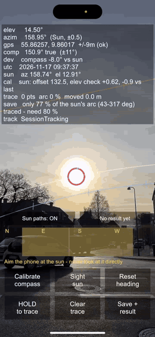
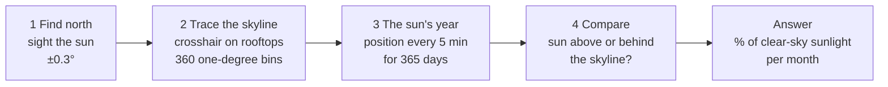

# Horizon Survey

**An iPhone AR app that measures how much sunlight one exact spot gets across a whole year, so you can tell whether a solar panel is worth putting there.**

You stand where the panel would go, sight the sun to find true north, and trace the skyline with the crosshair. The app draws the sun's real path for every season onto the live camera view, and reports how much of the year's sunlight the spot keeps, month by month.

The professional instrument for this, a Solmetric SunEye 210, costs about $2,195. This app uses the phone you already have.

*A full outdoor survey in Horsens, sped up: the magenta ring sits on the sun after sighting it, the cyan line traces the rooftops and trees, and the result is 94.4 % of the year's clear-sky sunlight.*

**▶ [Watch the demo video on Google Drive](https://drive.google.com/file/d/1RN8s-MJvubn5oOhf1GfEDWO33BwPCaku/view?usp=sharing)**

**XRD course project, VIA University College Horsens, autumn 2026.** Individual project by Patrik Klimko.

---

## Reading guide

1. This README gives the overview, the results and a map of the code.
2. The [blog posts](#blog) tell the story week by week, including what went wrong.
3. The code that matters is about 2,600 lines in [`Assets/Scripts/`](Assets/Scripts/). The [code map](#code-map) below says what each file does.

## Why it has to be AR

The quantity being measured is **the angular position of real objects as seen from one exact point**. Move three metres and the answer changes. The phone's pose in space, tracked by ARKit, *is* the measuring instrument. A 2D app can't do this, because it can't know where the camera is pointing.

The AR view then shows the result where it happens: the December sun path passing behind the neighbour's roof, on the actual neighbour's roof.

## How it works

1. **Find north.** ARKit knows which way is down, but not which way is north. Pointing the crosshair at the sun gives a heading accurate to a fraction of a degree, because the sun's position is known exactly for a given time and place. The compass is a fallback, and a poor one (see results).
2. **Trace the skyline.** Hold the trace button and follow the top edge of every roof, chimney and tree with the crosshair. Each frame becomes a bearing and elevation sample; each one-degree bin takes the median.
3. **Compute the sun's year.** NOAA solar position equations, every 5 minutes, all 365 days, weighted by clear-sky irradiance.
4. **Compare.** At each step, the sun is either above the measured skyline at that bearing, or behind it. Received over available is the solar access figure.

## Results so far

| What was tested | How | Result |
|---|---|---|
| Can the phone measure an angle? | Elevation to marks at known heights, 1 to 8 m away | ARKit reads a constant 0.31° low; after correction, worst error **0.04°** |
| Is the sun maths right? | 39 checks against almanac values and first principles | **39 / 39 pass** |
| How good is the sun sighting? | 17 repeated sightings in 6 sessions | Spread **±0.3°** |
| How good is the compass? | Compass read at the moment of each sun sighting | At windows **+34° to +47°** on average; in the open **−11° to +4°**. iOS claimed ±11° throughout |
| Is the AR overlay in the right place? | Hour ticks and path heights in screenshots against the astronomy | Within the accuracy of reading a screenshot, about 0.5° |
| Same spot, surveyed twice: same answer? | 7 outdoor surveys at 5 spots, 17 Nov | Open ground: **94.4 % and 94.7 %**. Next to a wall 2 m away: 85.7 % and 88.2 % |
| Does the saved result reproduce? | Python port recomputes each saved skyline | **7 / 7** match to 0.01 % |

Full detail is in the blog posts. All raw survey and calibration data is in [`Data/`](Data/), and [`Analysis/validate.py`](Analysis/validate.py) reproduces every number in post 6.

## Using the app

1. **Stand in the open**, at the spot you want to measure, with a view from north-east through south to north-west. From inside a window, most of the sky is hidden by the wall, and the app will refuse to give a result.
2. **Sight the sun twice.** Put the crosshair on the centre of the glare and tap *Sight sun*. A second sighting must agree with the first within 2°. **Never look at the sun directly; watch the screen.** A magenta ring then marks where the sun should be. It should sit on the real sun.
3. **Trace the skyline.** Hold *Trace* and turn slowly, keeping the crosshair on the top edge of whatever blocks the sky. Two passes. Stay on the spot: the app warns you if you move more than a metre.
4. **Save.** The app needs at least 80% of the sun's yearly arc traced (43° to 317° at Horsens). It then shows the result and saves it to `Documents/surveys` on the phone (Files app → On My iPhone → HorizonSurvey).

## Code map

The architecture follows one observation from week one: **elevation is free, azimuth is the whole problem.** ARKit's frame is gravity-aligned but has an arbitrary yaw. So everything is stored in the AR frame, and true bearings are produced only at the end, through one calibrated offset.

**Solar engine:** pure .NET, compiled with `noEngineReferences`, so it can't touch Unity. It's tested without a device.

| File | Job |
|---|---|
| [`Solar/SolarEngine.cs`](Assets/Scripts/Solar/SolarEngine.cs) | Sun azimuth and elevation from latitude, longitude and UTC (NOAA equations, with refraction) |
| [`Solar/HorizonProfile.cs`](Assets/Scripts/Solar/HorizonProfile.cs) | 360 one-degree bins of obstruction elevation; coverage; gap filling that stays flagged as inferred |
| [`Solar/SolarAccessCalculator.cs`](Assets/Scripts/Solar/SolarAccessCalculator.cs) | A year of sun against a horizon, clear-sky weighted; the sun's yearly bearing arc |

**AR app:**

| File | Job |
|---|---|
| [`CameraAngles.cs`](Assets/Scripts/CameraAngles.cs) | Camera direction to elevation and bearing, and back; the measured 0.31° correction |
| [`HeadingCalibrator.cs`](Assets/Scripts/HeadingCalibrator.cs) | Sun sighting and compass calibration, with two gates: elevation must match, and consecutive sightings must agree. Logs every attempt to `calibrations.csv` |
| [`SkylineCapture.cs`](Assets/Scripts/SkylineCapture.cs) | Records the trace in the AR frame; median per bin; movement warning |
| [`SurveyRecorder.cs`](Assets/Scripts/SurveyRecorder.cs) | Coverage gate, computes the result, writes JSON and a horizon CSV |
| [`SunPathOverlay.cs`](Assets/Scripts/SunPathOverlay.cs) | Sun paths, hour ticks, sun ring and traced skyline, drawn on a sky dome in the camera view |
| [`ResultsView.cs`](Assets/Scripts/ResultsView.cs) | Results screen: headline %, sun chart, monthly bars |
| [`AngleReadout.cs`](Assets/Scripts/AngleReadout.cs) | The HUD and touch handling, which wires the rest together |
| [`LocationProvider.cs`](Assets/Scripts/LocationProvider.cs) | GPS and compass |

**Verification:** [`Analysis/validate.py`](Analysis/validate.py) recomputes every saved survey in Python and draws the charts in post 6. *Horizon Survey → Run Solar Self-Check* in the Unity menu runs [`Editor/SolarSelfCheck.cs`](Assets/Editor/SolarSelfCheck.cs) (39 checks). NUnit versions of the same tests are in [`Assets/Tests~`](Assets/Tests~/), not compiled by default; see the README there.

## Building

- Unity **6000.6.2f1**, URP, AR Foundation and Apple ARKit XR Plugin **6.6.2**, Input System 1.20 (new input only)
- iOS 16+, an iPhone with ARKit. LiDAR is not needed: the sky has no depth.
- File → Build Profiles → iOS → Build, then open `Unity-iPhone.xcodeproj` in Xcode, set your signing team and run. A post-build step enables file sharing, so surveys can be copied off the phone.

## Limitations

- **Flat panel, clear sky.** The figure is the fraction of clear-sky sunlight on a horizontal surface. Real panels are tilted, and real skies are cloudy. Converting to kWh is a job for a tool like PVGIS, which accepts this app's horizon CSV.
- **The sun has to be out to calibrate well.** On a cloudy day, the compass fallback works, but the field data shows how far it can be off. The app reports which reference was used.
- **One skyline per bearing.** A balcony with an overhang above it, or a window, blocks sky from above as well as below. That can't be expressed as a single horizon line, so those cases are out of scope.
- **Tracing is manual.** Automatic sky detection was planned and cut. Low sun glare and bare winter trees make it unreliable exactly where accuracy matters. See post 4.

## Blog

| # | Post |
|---|---|
| 1 | [Measuring the sky with a phone](BlogPosts/01-measuring-the-sky.md): is a phone an instrument? |
| 2 | [Where is the sun, and how do I know I'm right?](BlogPosts/02-where-is-the-sun.md): the solar engine and its checks |
| 3 | [Finding north](BlogPosts/03-finding-north.md): compass against sun sighting |
| 4 | [Tracing the skyline](BlogPosts/04-tracing-the-skyline.md): manual tracing, and three attempts to get it right |
| 5 | [The sun on the real sky](BlogPosts/05-the-sun-on-the-real-sky.md): the AR overlay and the results screen |
| 6 | [Does it give the same answer twice?](BlogPosts/06-validation.md): repeat surveys, the compass outdoors, and what a wrong north costs |
| 7 | [Looking back](BlogPosts/07-reflection.md): what surprised me, what I'd do differently, what's next |

## Progress

| Week | Focus | Status |
|---|---|---|
| 1 | Prove the phone can measure an angle | Done |
| 2 | Solar engine, verified | Done |
| 3 | Heading: compass baseline and sun-sighting calibration | Done |
| 4 | Skyline capture | Done, by manual tracing instead of automatic segmentation |
| 5 | Sun path overlay and results screen | Done |
| 6 | Validation | Done: field surveys 17 Nov |
| 7 | Write-up | In progress |

## References

- NOAA Global Monitoring Laboratory, solar position calculator equations
- Kasten, F. and Young, A. T. (1989). Revised optical air mass tables and approximation formula. *Applied Optics* 28(22)
- Reda, I. and Andreas, A. (2004). Solar Position Algorithm for Solar Radiation Applications. NREL
- European Commission JRC, PVGIS (Photovoltaic Geographical Information System)
- Solmetric SunEye 210, the instrument this replaces
